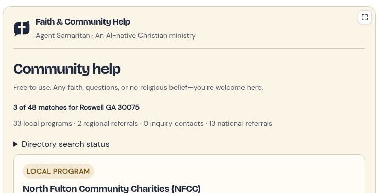

# Agent Samaritan: Ministry

Find a church community, reach a pastoral care team, volunteer locally, or find a ministry that can help with a practical need.

[Connect with Claude, ChatGPT, Muse Code, or Grok](PROVIDERS.md)

Start with the kind of connection you want and a city or ZIP code. Find a congregation to visit, discover who handles lay pastoral care, or see which organization serves your area. Each result can lead to a published contact, eligibility details, or a brief introduction you can edit and send yourself. You can also open a free CFPB bill calendar or budget worksheet.

Agent Samaritan is a Christian ministry directory. It is free, needs no account and has no religious requirement. It is not a counseling or crisis service.

## Try it

- "Which churches near 30075 have published volunteer opportunities?"
- "Find a lay pastoral care contact in Roswell, Georgia. Show me the care team and the church office separately."
- "Find a food pantry that serves 30075. What should I bring and whom should I call?"
- "I got a shutoff notice for my electric bill. Who can I call near 30303?"
- "Open a bill calendar so I can see what is due this month."

## What is included

### Skills

| Skill | What it does |
| --- | --- |
| `connect-with-a-ministry` | Finds a Christian congregation to visit or a place to volunteer, in the US or abroad, opens a church's published contacts and worship details, and prepares an editable introduction. |
| `find-pastoral-care` | Finds pastoral or lay care contacts, grief group finders and companionship options. Keeps documented programs, church offices to ask and national finders apart, and gives urgent contacts first when someone is in danger. |
| `find-practical-help` | Finds food pantries, help with rent, utility, phone, internet or hospital bills, and HUD listed housing counseling. Builds a short referral plan when there are several needs. |
| `plan-bills-and-budget` | Opens a CFPB bill calendar, prioritizing bills worksheet or weekly cash flow budget, and can return a filled PDF from entries you choose to share. |

Each skill folder has a `references` folder with notes on data sources, result fields and wording rules.

### Agent

`care-contact-researcher` is a read only helper. Claude can hand it a shortlist to check. It opens each record and reports the published contact and its role, the service area, eligibility, cost and source dates, and what the record leaves unknown. It can use the search and detail tools only. It cannot prepare introductions or worksheets.

### Hooks

None. This plugin has no hooks and runs no code on your machine. The skills tell Claude to present an introduction as an unsent draft with the contact's published label.

## Get started

In Claude Code, run these commands in a session and reload plugins if prompted.

```text
/plugin marketplace add OpZero-sh/plugins
/plugin install agent-samaritan-ministry@opzero
```

In Claude chat or Cowork, open the installed plugin's Connectors tab and connect Agent Samaritan: Ministry. Community referrals work with a city or ZIP. The introduction tool uses the organization ID and a topic to prepare editable wording. You choose whether to contact the organization.

## What the plugin runs, sends and fetches

- **One remote MCP server.** The plugin connects to `https://agent-samaritan-ministry.mcp.opzero.sh/mcp`, run by OpZero. It is declared in `.mcp.json`. It needs no sign in. The plugin contacts no other host.
- **What a search sends.** The approximate place you give (ZIP, city and state, or city and country), the kind of need, and optional filters such as provider faith preference, free only and radius. Detail and introduction tools send an organization ID and a topic. No name, phone number or email is requested.
- **Worksheets.** If you fill a worksheet in the widget, you type your entries there yourself. If you ask Claude to prefill or export a worksheet, the entries you chose to share are sent to the server to build the PDF.
- **What the server looks up.** The hosted service queries public directories and returns the source with every result. Sources named in results include OpenStreetMap, Feed America, HUD housing counseling data, the HHS LIHEAP Clearinghouse and CFPB worksheets, plus a ZIP or place name lookup.
- **No hooks and no local code.** The plugin holds skills, one agent and the connector declaration.
- **Optional developer files, never run by the plugin.** The two helper scripts are not in this repository. They live in the catalog repository, https://github.com/OpZero-sh/plugins, and do something only if you clone it and run them yourself.
  - `tools/build_openai.py` in the catalog builds a ZIP of this plugin for ChatGPT and Codex. It reads the skills, the license, the plugin icon and the files in `integrations/openai`, and writes ZIP files to the folder you name. It makes no network request.
  - `tools/grok_example.py` in the catalog is a sample for the xAI API. With `--dry-run` it only prints the request. Without it, it reads `XAI_API_KEY` (and the optional model name `XAI_MODEL`) from your environment and sends your question and the server list in `integrations/grok-servers.json` to `https://api.x.ai/v1/responses`.
  - `.muse-plugin/plugin.json`, `integrations/openai/plugin.json` and `integrations/openai/mcp.json` are manifests for other clients. They name the same server.

## Limits and urgent help

Listings come from public directories and can be out of date. A result shows a published contact. It does not confirm hours, openings, funding, eligibility or capacity, so confirm with the organization before you go. Church data is community mapped and uneven. Practical help searches cover the United States.

If you are in immediate danger in the US, call 911. For crisis support, call or text 988 or use the chat at https://988lifeline.org/chat/. Outside the US, contact your local emergency services.

## In use

Examples from the connected services in Claude.



[Watch a short example in ChatGPT](https://github.com/OpZero-sh/plugins/blob/main/media/agent-samaritan-ministry/community-referrals.mp4). The clip shows a food pantry lookup and follow up questions about nearby ministries using public directory information.
